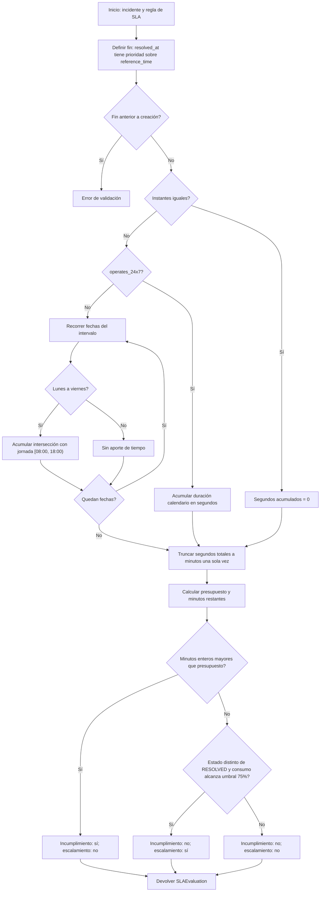

# ADR-002: Cálculo de SLA en horario hábil

- **Estado**: Aceptado
- **Fecha**: 2026-11-17
- **Autor(es)**: Juan David González Muñoz
- **Componentes Afectados**: [`src/sla_calculator.py`]

---

## 1. Contexto y Problema

En el proyecto IncidentOps (ISIA Semana 1), `evaluate_sla_status` evalúa el consumo del presupuesto de resolución de un incidente y determina su estado de incumplimiento y escalamiento.

Actualmente, la función calcula el tiempo transcurrido mediante la diferencia calendario entre el instante final y `created_at`, independientemente de `operates_24x7`. Esto produce un consumo incorrecto del presupuesto para P2 y P3 durante noches y fines de semana.

La política vigente establece:

| Severidad | Presupuesto de resolución | Horario aplicable |
| :--- | :--- | :--- |
| P0 | 60 minutos | 24/7 |
| P1 | 240 minutos | 24/7 |
| P2 | 480 minutos | Lunes a viernes, de 08:00 a 18:00 |
| P3 | 1440 minutos | Lunes a viernes, de 08:00 a 18:00 |

La función es invocada desde `incident_repository` y desde `_run_demo`, que incluye un incidente P2 entre el viernes a las 17:00 y el lunes a las 09:00. En ese intervalo deben contabilizarse 120 minutos hábiles, no toda la duración calendario.

La corrección debe respetar los contratos existentes de selección del instante final, precisión, incumplimiento, tiempo restante y escalamiento, sin modificar los modelos `SLARule`, `Incident` y `SLAEvaluation`.

---

## 2. Opciones Consideradas

1. **Opción A — Recorrido día a día con intersección de jornadas hábiles** (seleccionada):
   - *Ventajas*: usa la biblioteca estándar; expresa explícitamente los límites temporales; complejidad O(D) en tiempo y O(1) en memoria.
   - *Desventajas*: el coste crece linealmente con la cantidad de fechas del intervalo, incluidas las no laborables.
2. **Opción B — Bibliotecas de horario hábil**:
   - *Ventajas*: abstracción lista para usar.
   - *Desventajas*: dependencias externas innecesarias. Descartada en la exploración previa.
3. **Opción C — Avance entre franjas hábiles**:
   - *Ventajas*: puede saltar directamente a la siguiente ventana abierta.
   - *Desventajas*: mayor complejidad de límites y estados. Descartada en la exploración previa.

Estas alternativas se registran como antecedente de la decisión acordada; no se reabre su evaluación.

---

## 3. Decisión Arquitectónica

Se utilizará un **recorrido día a día con clipping por intersección de jornadas hábiles**, implementado exclusivamente con la biblioteca estándar.

### Selección y validación del intervalo

- `created_at` define el inicio.
- `resolved_at`, cuando exista, tiene prioridad sobre `reference_time` para determinar el instante final.
- Si el instante final es anterior a `created_at`, la evaluación debe producir un error.
- Si ambos instantes son iguales, el tiempo transcurrido es cero.
- El intervalo evaluado será semiabierto: `[inicio, fin)`.

### Cálculo del tiempo computable

La regla de SLA determina el modo de cómputo:

- `operates_24x7=True`: se contabiliza toda la duración del intervalo.
- `operates_24x7=False`: se recorren las fechas comprendidas en el intervalo. Para cada lunes a viernes se considera la jornada semiabierta `[08:00, 18:00)` y se acumula únicamente su intersección con `[inicio, fin)`. Los sábados y domingos no aportan tiempo.

La intersección queda delimitada por el mayor de los inicios y el menor de los finales. Solo aporta duración cuando el límite final es posterior al inicial.

El mismo procedimiento cubre intervalos que atraviesan varios fines de semana, sin tratamientos especiales.

### Precisión y compatibilidad

Se acumularán segundos y se truncará a minutos enteros **una sola vez** al finalizar. No se truncarán por separado las contribuciones de cada jornada.

Con los minutos enteros resultantes:

- `allowed_minutes` conserva el presupuesto de la regla.
- `remaining_minutes` es el presupuesto menos el tiempo transcurrido y puede ser negativo.
- `is_breached` es verdadero únicamente cuando `elapsed_minutes > allowed_minutes`.
- `requires_escalation` es verdadero únicamente si el incidente no está `RESOLVED`, no está incumplido y ha consumido al menos el umbral configurado (75 % por defecto).

Por compatibilidad, alcanzar exactamente el presupuesto no constituye incumplimiento. Si el incidente sigue sin resolver, puede permanecer en escalamiento en ese punto. Al superar el presupuesto en minutos enteros, se activa el incumplimiento y se desactiva el escalamiento de forma intencional.

### Flujo de evaluación

### Complejidad y alcance

Para reglas de horario hábil, el cálculo tendrá complejidad temporal O(D), donde D es el número de fechas recorridas, y memoria auxiliar O(1). El cálculo 24/7 conserva un coste constante.

Quedan fuera de alcance:

- Festivos.
- Pausas del SLA.
- Cambios de política durante la vida del incidente.

La zona horaria de negocio queda como contrato pendiente. Esta decisión no fija una zona ni incorpora reglas de conversión horaria.

---

## 4. Consecuencias e Impacto

### Positivas

- P2 y P3 dejan de consumir presupuesto fuera del horario establecido.
- P0 y P1 conservan su cálculo continuo.
- Los intervalos semiabiertos y el clipping definen un tratamiento uniforme de los límites.
- La acumulación en segundos evita pérdidas por truncamiento independiente de cada jornada.
- No se añaden dependencias externas ni se modifican los modelos de entrada y salida.
- Se preservan las reglas existentes de incumplimiento, tiempo restante y escalamiento.

### Negativas / Trade-offs

- El coste del cálculo hábil crece linealmente con la cantidad de fechas del intervalo, incluidas las no laborables.
- El calendario adoptado no representa festivos ni otras excepciones operativas.
- La zona horaria de negocio sigue pendiente de definición contractual.
- Se mantiene una semántica deliberadamente estricta: el incumplimiento requiere superar el presupuesto en minutos enteros, no simplemente alcanzarlo.
- Un incidente incumplido deja de marcarse para escalamiento. Este comportamiento es intencional y debe conservarse.

### Verificación

Se comprobarán los siguientes resultados para reglas de horario hábil:

| Caso | Resultado esperado |
| :--- | :--- |
| Viernes 18:30 → lunes 08:30 | 30 minutos |
| Sábado 10:00 → lunes 09:00 | 60 minutos |
| Intervalo íntegramente en fin de semana | 0 minutos |
| Viernes 17:00 → lunes 09:00 | 120 minutos |
| Día hábil 08:00 → 18:00 | 600 minutos |
| Día hábil 18:00 → día hábil siguiente 08:00 | 0 minutos |
| Inicio y fin iguales | 0 minutos |
| Fin anterior a creación | Error de validación |

Además, la verificación debe cubrir:

- Varios fines de semana: acumular exclusivamente las intersecciones con jornadas hábiles.
- Precisión: dos contribuciones hábiles de 30 segundos deben sumar un minuto al truncar el total.
- Reglas 24/7: contabilizar también noches y fines de semana.
- Prioridad temporal: utilizar `resolved_at` aunque exista un `reference_time` diferente.
- Umbral de escalamiento: activarlo al alcanzar el 75 % para incidentes no resueltos y no incumplidos.
- Límite de presupuesto: con presupuesto de 480 minutos, 480 minutos enteros no implican incumplimiento; 481 sí.
- Tiempo restante: permitir valores negativos cuando se superen el presupuesto.
- Estado resuelto: mantener `requires_escalation=False`.
- Incumplimiento: mantener `requires_escalation=False` cuando `is_breached=True`.
- Integración: verificar que las evaluaciones obtenidas desde `incident_repository` y `_run_demo` respeten el mismo contrato.
