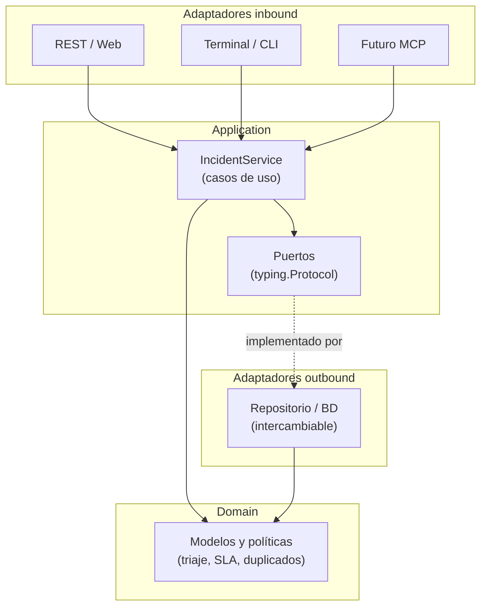

# ADR-003: Adopción de Arquitectura Hexagonal (Puertos y Adaptadores) para IncidentOps

- **Estado**: Propuesto
- **Fecha**: 2026-11-21
- **Autor(es)**: Juan David González Muñoz
- **Reemplaza a**: *(N/A — no sustituye ADR-002; redefine la organización estructural del sistema alrededor del dominio ya estabilizado)*

---

## 1. Contexto y Problema

IncidentOps ya tiene núcleo de dominio usable: triaje determinista, evaluación de SLA
(ADR-002) y un repositorio SQLite de demostración en un layout plano bajo `src/`. El
roadmap exige **múltiples interfaces de consumo** (web y terminal), **persistencia
real** del ciclo de vida y, más adelante, **motor relacional dedicado** con runtime
reproducible.

La decisión estructural a tomar es **dónde viven las reglas de negocio y cómo se
acoplan (o no) a los mecanismos de entrega y de almacenamiento**. Si el dominio
depende directamente del framework web o del driver de BD, cada nuevo canal
(REST, CLI, futuro MCP) o cambio de persistencia (SQLite → motor dedicado) fuerza
a reescribir o contaminar la lógica de triaje, duplicados y SLA.

Restricciones vigentes:

- Preservar el determinismo y los contratos de dominio ya aceptados (severidades,
  equipos, cálculo de SLA).
- No inventar requisitos de producto fuera de `docs/ROADMAP.md` y ADRs.
- Preferir stdlib / tipado nativo para contratos internos; evitar acoplar el núcleo
  a un stack de entrega concreto.

---

## 2. Opciones Consideradas

Documenta al menos **2 opciones arquitectónicas reales** (sin opciones de relleno):

1. **Opción A — Arquitectura en capas tradicional acoplada a FastAPI/SQLite**:
   - *Ventajas*: llegada rápida a una API única; el código de demo actual
     (`incident_repository` + módulos de dominio en el mismo paquete) se “envuelve”
     con poca ceremonia; curva corta para un solo canal HTTP.
   - *Desventajas*: el dominio tiende a importar detalles de framework, esquemas de
     request/response y SQL; CLI y futuros canales compiten por la misma capa o
     duplican casos de uso; cambiar de motor de BD o añadir MCP implica tocar el
     núcleo o proliferar atajos; el acoplamiento hace costoso revertir la decisión
     una vez hay varios consumidores.

2. **Opción B — Arquitectura Hexagonal (Puertos y Adaptadores)**:
   - Núcleo en `src/domain/` (modelos y políticas de triaje/SLA).
   - Casos de uso en `src/application/` detrás de puertos (`typing.Protocol`) y
     orquestación vía un servicio de aplicación (p. ej. `IncidentService`).
   - Adaptadores en `src/adapters/{inbound,outbound}/` (entrada: REST, CLI, futuro
     MCP; salida: repositorios / motores de BD intercambiables).
   - *Ventajas*: el dominio no conoce frameworks ni SQL; web y terminal (y MCP)
     son adaptadores inbound simétricos; H004 puede sustituir el adaptador de
     persistencia sin reescribir triaje/SLA; dirección de dependencias explícita
     y testeable en aislamiento.
   - *Desventajas*: más carpetas y contratos al inicio; requiere disciplina para no
     filtrar DTOs de transporte hacia el dominio; coste de cableado
     (composición/DI) frente a un monolito de capas “todo en la API”.

---

## 3. Decisión Arquitectónica

Se elige la **Opción B — Arquitectura Hexagonal**.

Motivo: el roadmap no es “una API con SQLite”, sino **varios puntos de entrada** y
**persistencia evolutiva**. Hexagonal fija una frontera estable alrededor del dominio
ya consolidado (triaje + SLA) y trata frameworks y BD como detalles sustituibles.
Los puertos (`Protocol`) + un servicio de aplicación concentran los casos de uso
(clasificar sin persistir, consultar activos, registrar con detección de
duplicados, auditar SLA en un instante de referencia) sin filtrarlos por canal.

El diagrama siguiente solo muestra **capas y dirección de dependencias** (hacia el
núcleo), no flujos algorítmicos.

Regla de dependencia: **inbound y outbound dependen del application/domain**; el
domain **no** importa adaptadores ni frameworks.

---

## 4. Consecuencias y Trade-offs

- **Positivas**:
  - Desacoplamiento entre reglas de negocio y canales de entrega (H001–H003).
  - Portabilidad del núcleo al cambiar persistencia o runtime (H004).
  - Mantenibilidad: tests del dominio/application sin levantar web ni BD real.
  - Extensión simétrica de nuevos inbound (p. ej. MCP) sin reabrir ADR-002.
- **Negativas / Trade-offs**:
  - Complejidad estructural inicial (paquetes, puertos, composición).
  - Riesgo de “hexágono ceremonial” si los puertos proliferan sin casos de uso
    reales del roadmap.
  - Coste operativo de mantener adaptadores alineados con los mismos contratos de
    aplicación; la migración desde el layout plano actual es un cambio difícil de
    revertir una vez existan varios consumidores.
