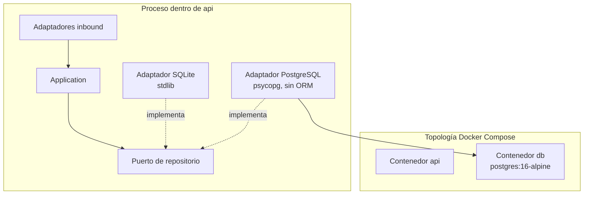

# ADR-004: Persistencia PostgreSQL y runtime en contenedores

- **Estado**: Propuesto
- **Fecha**: 2026-11-24
- **Autor(es)**: Juan David González Muñoz
- **Reemplaza a**: *(ADR-001, parcialmente: solo la restricción de "solo sqlite3 sin dependencias externas". Siguen vigentes el rechazo a un ORM pesado y la selección del motor por `DATABASE_URL`. No sustituye ADR-002 ni ADR-003.)*

---

## 1. Contexto y Problema

ADR-003 dejó la persistencia detrás de un puerto outbound intercambiable. Hoy ese
puerto tiene una sola implementación: SQLite de la biblioteca estándar, embebido
en el proceso de la API. La constitución atribuye a ADR-001 la regla de permanecer
en ese motor, sin dependencias externas y sin ORM, hasta que un ADR autorice otro.
ADR-001 no tiene archivo en `docs/adr/`; la restricción vive solo como cita.

El roadmap (H004) pide otra cosa: un motor relacional dedicado y un runtime
reproducible en contenedores, con comprobación de conectividad del servicio de
datos. Un archivo SQLite dentro del proceso no es ese motor, y un motor dedicado
es un proceso distinto. Elegir el motor y elegir la topología son el mismo corte:
revertirlo obliga a retirar el driver, el segundo adaptador y el servicio de base
de datos a la vez.

La decisión es **adoptar persistencia dual SQLite/PostgreSQL, sin ORM, ejecutada
en una topología de dos contenedores**. No reabre el cálculo de SLA (ADR-002) ni
las fronteras hexagonales (ADR-003).

Restricciones vigentes:

- El dominio no importa drivers ni conoce el motor.
- Los instantes de negocio siguen siendo los que ya fija el núcleo (naive; si hay
  resolución, ese instante manda). Los dos motores tienen que persistirlos igual.
- Las credenciales no se escriben en código ni en este registro; llegan por el
  entorno.
- Sigue prohibido un ORM pesado.

---

## 2. Opciones Consideradas

1. **Opción A — SQLite embebido y un solo contenedor (restricción vigente de ADR-001)**:
   - *Ventajas*: cero dependencias de driver; la aceptación y la demo siguen en un
     proceso, con archivo o memoria; no hay red ni credencial de base de datos; un
     solo artefacto que versionar y arrancar.
   - *Desventajas*: el puerto no puede cumplir H004. El dato comparte el ciclo de
     vida del proceso de la API (archivo en el contenedor o en un volumen acoplado
     a él). No existe un servicio cuya conectividad se pueda comprobar aparte.
     Introducir después un motor dedicado reescribe el acceso y el despliegue a la
     vez, que es justo el coste que esta decisión quiere pagar una sola vez.

2. **Opción B — PostgreSQL como único motor, SQL explícito y tipos temporales nativos**:
   - *Ventajas*: un solo dialecto y un solo adaptador; `timestamptz` expresa zona
     e intervalos sin convención de aplicación; la topología es clara (la API
     siempre depende del servicio `db`); no hay que mantener un subconjunto SQL
     común con SQLite.
   - *Desventajas*: desaparece el camino stdlib. Cada prueba, demo y arranque local
     necesita el servidor, o un sustituto que ya no es el adaptador real. Los
     instantes dejan de ser el mismo literal en todos los entornos, y el núcleo
     pasa a depender de la semántica temporal de PostgreSQL. Quitar el adaptador
     SQLite es difícil de revertir cuando la aceptación ya aísla un archivo por
     caso. Sigue haciendo falta un driver externo, así que no preserva ADR-001.

3. **Opción C — Dual SQLite/PostgreSQL sin ORM, selección por `DATABASE_URL`, instantes en TEXT ISO 8601, Compose `api` + `db`**:
   - *Ventajas*: el puerto de ADR-003 gana un segundo adaptador sin tocar el
     dominio. SQLite (`sqlite:///`, stdlib) sigue sirviendo aceptación y demo;
     PostgreSQL (`postgresql://`, `psycopg` sin ORM) es el motor dedicado. El
     mismo literal ISO 8601 en columnas TEXT da paridad temporal entre motores.
     La topología de H004 queda explícita: contenedor `api` y contenedor `db`
     (`postgres:16-alpine`). La etiqueta mayor fija el motor; Alpine mantiene la
     imagen pequeña porque el servicio solo necesita un servidor estándar.
   - *Desventajas*: hay que escribir y cuidar dos dialectos sobre un subconjunto
     común (nada de tipos ni funciones exclusivos de un motor en el esquema
     compartido). `psycopg[binary]` es una dependencia externa y deroga en parte
     ADR-001; el wheel trae su propia libpq y ata la imagen a las plataformas que
     ese wheel cubre. TEXT renuncia a `timestamptz` (zona, operadores de intervalo
     y el índice temporal nativo). Compose añade un segundo proceso, red interna
     y un secreto de entorno que el proceso único no tenía.

---

## 3. Decisión Arquitectónica

Se elige la **Opción C**.

H004 no pide "tirar SQLite", pide un motor dedicado y un arranque reproducible
junto a la API. La opción A no llega. La opción B llega, pero borra el adaptador
stdlib que ya aísla la aceptación y parte en dos la representación de los
instantes. El dual conserva el puerto: `DATABASE_URL` elige el adaptador en la
frontera outbound (`sqlite:///` sigue en stdlib; `postgresql://` usa
`psycopg[binary]`, driver y no ORM). El extra `binary` evita meter un compilador
y libpq de sistema en la imagen de la API.

Los instantes se guardan como **TEXT en ISO 8601** en los dos motores. Así el
valor que lee el núcleo no depende de cómo cada motor tipa una fecha. La paridad
es la restricción; el tipo nativo de PostgreSQL queda fuera a propósito.

La topología es **Docker Compose con dos servicios**: `api` y `db`
(`postgres:16-alpine`). La API habla con PostgreSQL por la red del compose cuando
la URL es `postgresql://`. SQLite no usa ese servicio: vive en el proceso de la
API. PostgreSQL 16 fija la generación del motor; Alpine es suficiente mientras no
hagan falta extensiones nativas fuera de musl.

Dirección de dependencias: inbound y adaptadores hacia application y el puerto.
El dominio no aparece en este corte porque no depende de ningún motor. La flecha
hacia `db` es de despliegue (red del compose), no un import del núcleo.

---

## 4. Consecuencias y Trade-offs

- **Positivas**:
  - El motor dedicado y el runtime dejan de ser ad hoc: dos contenedores con
    responsabilidades separadas (proceso de la API y proceso de datos).
  - El núcleo y los casos de uso siguen libres de driver y de ORM. Cambiar de
    esquema de URL no reabre ADR-002 ni ADR-003.
  - Paridad temporal: el mismo TEXT ISO 8601 en SQLite y en PostgreSQL.
  - La aceptación puede seguir en SQLite de archivo o memoria; el entorno
    reproducible usa el servicio `db`.
- **Negativas / Trade-offs**:
  - Dependencia externa `psycopg[binary]`. Deroga solo la frase de ADR-001
    "solo sqlite3 sin dependencias externas". El ORM pesado sigue prohibido.
  - Coste de mantener un SQL común. Un atajo exclusivo de PostgreSQL rompe la
    paridad y hay que tratarlo como otra decisión, no como un detalle local.
  - TEXT no da la semántica de `timestamptz`. Corregir zona u orden en el motor
    sería otro corte, difícil de revertir una vez haya datos en los dos formatos.
  - Superficie operativa nueva: imagen `postgres:16-alpine`, red entre `api` y
    `db`, secreto por entorno, y un chequeo de conectividad que el archivo
    embebido no necesitaba.
  - ADR-001 no está en `docs/adr/`, así que no hay **Estado** que pasar a
    `Reemplazado por ADR-004`. La derogación parcial queda registrada solo aquí.
    Mientras este ADR siga en `Propuesto`, la cita de la constitución a ADR-001
    no cambia.
